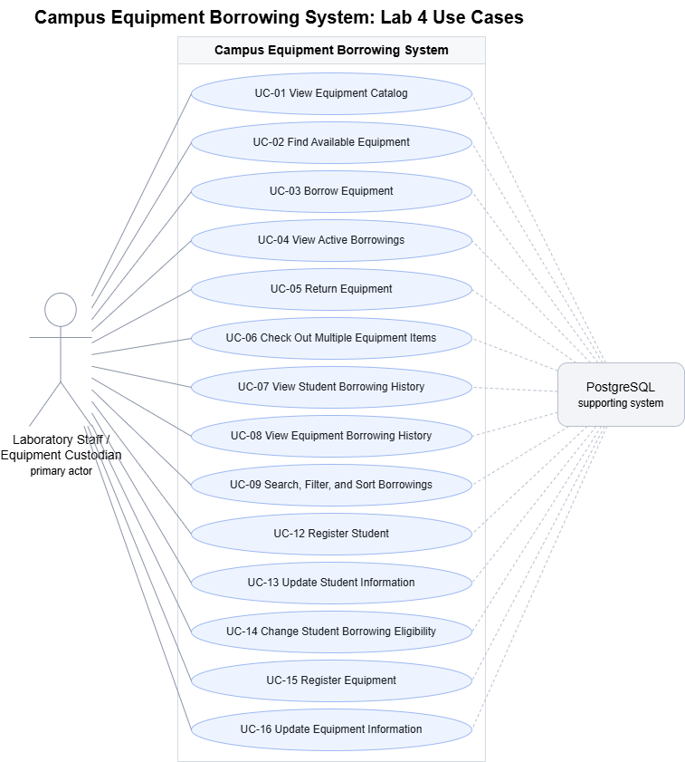

# Use Case Catalog (Lab 4)

**Primary actor:** Laboratory Staff / Equipment Custodian. **Supporting system:** PostgreSQL (all cases).
No include/extend relationships are used: validation is internal to each use case.

| ID | Use case | Lab 4 classification |
|---|---|---|
| UC-01 | View Equipment Catalog | Required continuation |
| UC-02 | Find Available Equipment | Required continuation |
| UC-03 | Borrow Equipment | Required continuation |
| UC-04 | View Active Borrowings | Required continuation |
| UC-05 | Return Equipment | Required continuation |
| UC-06 | Check Out Multiple Equipment Items | Required new |
| UC-07 | View Student Borrowing History | Required new |
| UC-08 | View Equipment Borrowing History | Required new |
| UC-09 | Search, Filter, and Sort Borrowings | Required new |
| UC-10 | View Overdue Borrowings | Deferred to Laboratory Activity 5 |
| UC-11 | View Current Equipment Holder | Deferred to Laboratory Activity 5 |
| UC-12 | Register Student | Required new |
| UC-13 | Update Student Information | Required new |
| UC-14 | Change Student Borrowing Eligibility | Required new |
| UC-15 | Register Equipment | Required new |
| UC-16 | Update Equipment Information | Required new |
| UC-17 to UC-27 | Retire / maintenance / restore equipment, return condition, renew, return multiple, due soon, active count, utilization, categories, void borrowing | Deferred to Laboratory Activity 5 |
| UC-28 to UC-33 | Reservations, approvals, audit history, staff accounts, export, external integrations | Future scope |

## Fourteen-case suite

The fourteen required use cases (UC-01 to UC-09 and UC-12 to UC-16) are specified in `use-case-suite.md`, adapted from the supplied *Lab Activity 4 Use Case Suite* with every required field, branch, rule and acceptance outcome preserved. Each table gains an *Implementation* row; see `traceability.md`.
